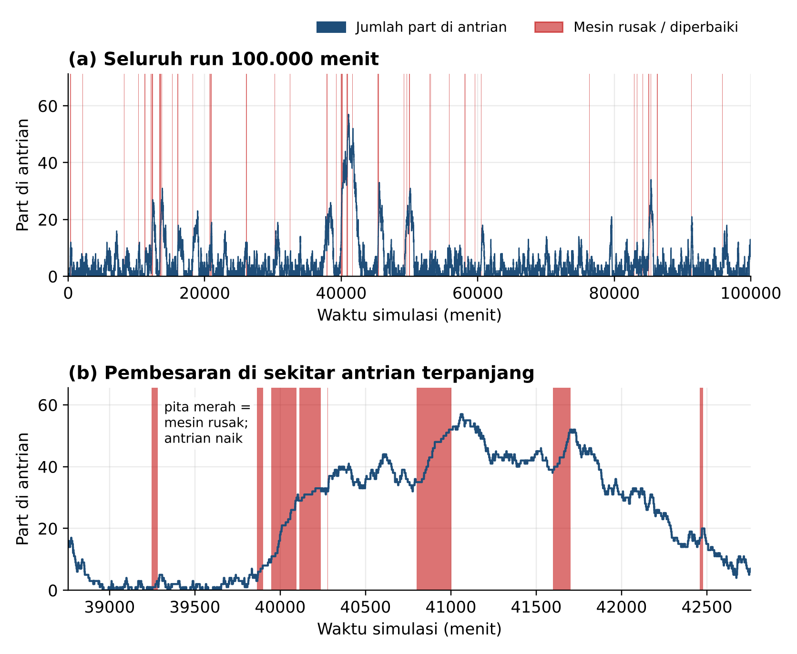
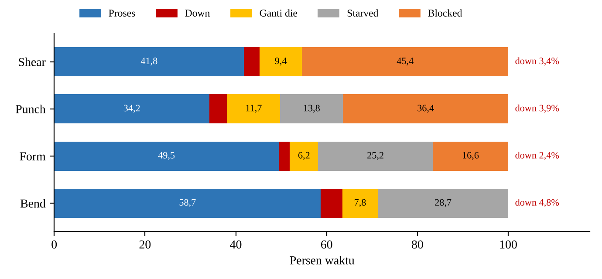
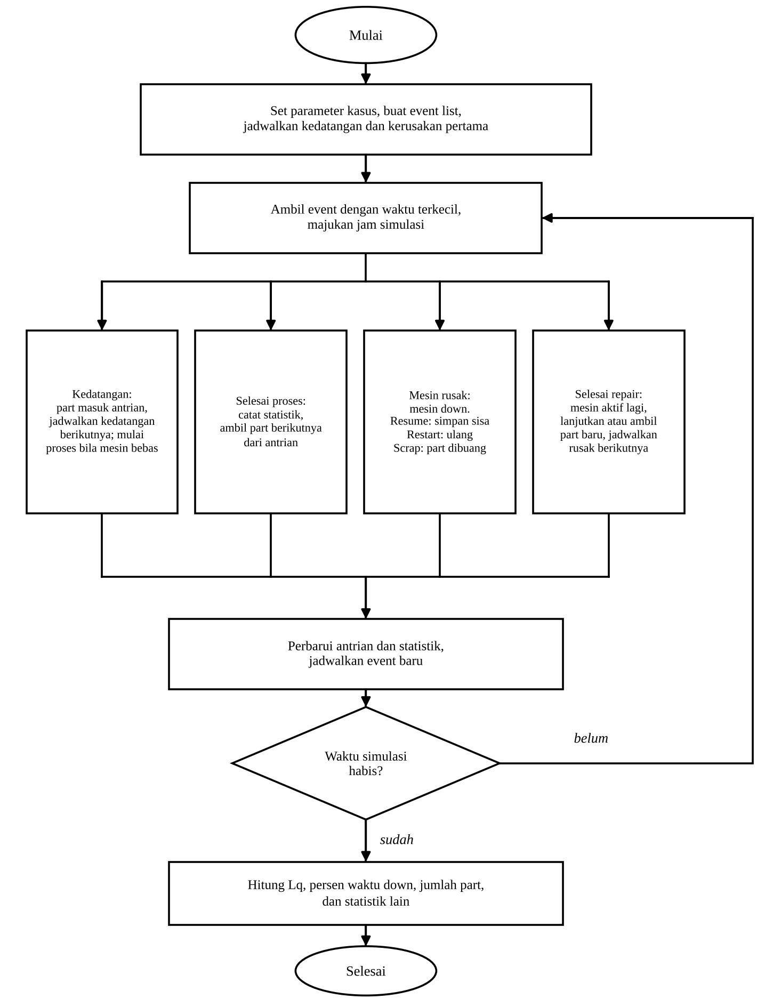

> Tugas Project studi kasus Chapter 13 buku *Discrete-Event System Simulation* (Jerry Banks, edisi ke-5), **Soal 10 sampai 14**.

---

## Anggota Tim

| No | Nama | NRP |
|----|------|-----|
| 1 | `Azil Alriansyah Hidayat` | `5025241070` |
| 2 | `Muhamad Aziz Romdhoni` | `5025241070` |

**Mata kuliah:** Pemodelan & Simulasi, Kelas D
---

## Soal

| Soal | Pertanyaannya | Model yang dipakai |
|------|---------------|--------------------|
| **10** | Apakah cara menyederhanakan kerusakan (diabaikan, waktu proses dinaikkan, dst.) memberi hasil yang sama dengan model kerusakan asli? Seberapa lama antrian pulih setelah repair? | `model_satu_mesin.py` |
| **11** | Bagaimana kalau mesin rusak **sering tapi singkat** (rata-rata tiap 2 menit, repair 0,1 menit)? Apakah kesimpulan Soal 10 tetap berlaku? | `model_satu_mesin.py` |
| **12** | Bagaimana kalau part yang kena kerusakan harus **diproses ulang dari awal**? | `model_satu_mesin.py` (mode `restart`) |
| **13** | Bagaimana kalau part yang kena kerusakan **dibuang (scrap)**? | `model_satu_mesin.py` (mode `scrap`) |
| **14** | Lini 4 press dengan kerusakan, ganti die, dan scrap 20%. Di mana terjadi penumpukan, dan bagaimana membagi 15 lembar buffer agar produksi maksimal? | `model_lini_4_press.py` |

---

## Temuan utama

**Soal 10: Menyederhanakan kerusakan itu berisiko.**
Dengan 30 replikasi, rata-rata antrian kasus C (semua acak) adalah **3,85 part**, sedangkan kasus A yang mengabaikan kerusakan hanya **2,22**. Kerusakan yang jarang tapi panjang sulit digantikan hanya dengan menaikkan waktu proses (kasus B: 3,15). Dari 340 kerusakan yang diamati terpisah, antrian baru kembali normal sekitar **710 menit** setelah repair selesai.



**Soal 11: Frekuensi kerusakan mengubah kesimpulan.**
Persentase waktu rusak sama di kedua kasus (**4,76%**), tetapi dampaknya berbeda. Pada kerusakan sering, sekitar **79% part** mengalami minimal satu downtime (±47.000 kerusakan per run) dan rata-rata antrian turun ke **2,88**. Di sini, menaikkan waktu proses efektif menjadi pendekatan yang jauh lebih masuk akal.

**Soal 12 dan 13: Aturan penanganan part menentukan stabil tidaknya sistem.**
Memproses ulang part dengan waktu proses konstan pada kerusakan sering membuat waktu selesai membengkak sekitar **87 menit per part**, jauh di atas waktu antar kedatangan 10 menit, sehingga antrian tidak stabil. Pada skenario scrap, **0,74%** part terbuang di kerusakan jarang, tetapi **78,6%** di kerusakan sering.

**Soal 14: Bend adalah bottleneck, dan buffer terbaik ada di depannya.**
Dengan buffer tak terbatas, produksi **157,9 lembar/jam** dan isi buffer sebelum Bend menumpuk paling banyak. Dengan total buffer 15 lembar, alokasi terbaik adalah **(1, 5, 9)**, yaitu **112,7 lembar/jam**. Alokasi (1, 7, 7) praktis setara (selisih −0,04).



> Angka lengkap, tabel, dan pembahasan ada di laporan Word.

---

## Cara kerjanya

- **Bahasa dan alat:** Python 3.9+, NumPy, Matplotlib.
- **Pendekatan:** simulasi event diskrit dengan *event scheduling*. Kejadian (kedatangan, selesai proses, rusak, selesai repair, ganti die) disimpan di antrian prioritas (`heapq`) dan diproses sesuai urutan waktu.
- **Bilangan acak:** setiap sumber keacakan punya aliran sendiri dengan seed tercatat, jadi **hasil bisa diulang persis**.
- **Replikasi:** 5 sampai 30 replikasi per skenario, dengan selang kepercayaan 95% bila perlu. Antar alokasi buffer di Soal 14 dipakai seed yang sama agar dapat dibandingkan secara berpasangan.

Diagram alur logika simulasi:



---

## Isi repo

```
.
├── model_satu_mesin.py                 # Model satu mesin (Soal 10-13)
├── model_lini_4_press.py               # Model lini 4 press (Soal 14)
│
├── eksperimen_soal_10_13.py            # Menjalankan semua skenario Soal 10-13
├── eksperimen_soal_14_buffer.py        # Menjalankan skenario buffer Soal 14
├── analisis_berpasangan_soal_14.py     # Uji berpasangan antar alokasi buffer
│
├── gambar_04_antrian_vs_waktu.py       # Gambar 4
├── gambar_05_pemulihan_antrian.py      # Gambar 5
├── gambar_grafik_batang.py             # Gambar 3, 6, 9, 12
├── gambar_diagram_alur.py              # Gambar 1, 2, 7, 8, 10, 11
│
├── hasil_soal_10_13.json               # Hasil simulasi
├── hasil_soal_14.json
├── hasil_soal_14_berpasangan.json
├── hasil_soal_14_alokasi_tambahan.json
├── hasil_pemulihan_antrian.json
│
├── gambar/                             # Semua gambar
│   ├── gambar_01_alur_resume.png
│   ├── gambar_02_logika_event.png
│   ├── gambar_03_lq_vs_buku.png
│   ├── gambar_04_antrian_waktu.png
│   ├── gambar_05_pemulihan_antrian.png
│   ├── gambar_06_lq_rendah_vs_tinggi.png
│   ├── gambar_07_alur_restart.png
│   ├── gambar_08_alur_scrap.png
│   ├── gambar_09_yield_scrap.png
│   ├── gambar_10_alur_lini_press.png
│   ├── gambar_11_logika_press.png
│   └── gambar_12_utilisasi_press.png
└── requirements.txt
```

---

## Menjalankan sendiri

```bash
# 1. pasang kebutuhan
pip install -r requirements.txt

# 2. jalankan eksperimen
python eksperimen_soal_10_13.py
python eksperimen_soal_14_buffer.py
python analisis_berpasangan_soal_14.py

# 3. buat gambar
python gambar_04_antrian_vs_waktu.py
python gambar_05_pemulihan_antrian.py
python gambar_grafik_batang.py
python gambar_diagram_alur.py
```

Uji cepat model press:

```bash
python model_lini_4_press.py
```

---

## Asumsi pemodelan

**Soal 10–13 (satu mesin)**
- Kerusakan dihitung berdasarkan waktu jam dinding: mesin bisa rusak saat sibuk maupun menganggur.
- Antrian FIFO. Run 100.000 menit, mulai dari sistem kosong.
- Kasus E (semua deterministik) cukup satu replikasi karena hasilnya selalu sama.

**Soal 14 (lini press)**
- Waktu proses konstan (1/laju). Waktu ke kerusakan eksponensial, dihitung dari waktu mesin sedang memproses.
- Waktu repair Uniform(rata-rata ± 5 menit). Ganti die 25 menit setelah N lembar.
- Saat rusak: 20% lembar dibuang, 80% diproses ulang dari awal setelah repair.
- Bila buffer hilir penuh, lembar tertahan di mesin dan mesin terblokir.

---
